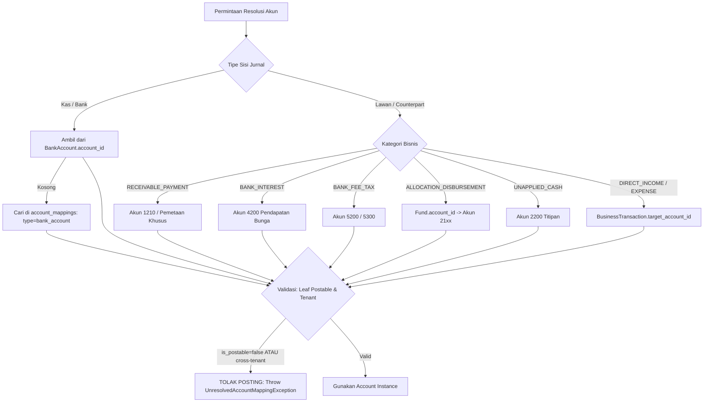

# PHASE 7 — ACCOUNTING AUTOMATION & DOUBLE-ENTRY JOURNAL POSTING
## TECHNICAL IMPLEMENTATION PLAN & ARCHITECTURAL SPECIFICATION (REVISED & VERIFIED)

**Project:** Sistem Keuangan LP Ma'arif NU PCNU Cilacap  
**Repository:** `ayebe51/Keuangan-Maarif`  
**Document Track:** `docs/phase_7/PHASE_7_IMPLEMENTATION_PLAN.md`  
**Previous Phase:** Phase 6 — Transaction Classification & Rules Engine (`docs/phase_6/PHASE_6_RESULT.md`)  
**Target Phase:** Phase 7 — Accounting Automation & Double-Entry Journal Posting  
**Specification Reference:** `Spesifikasi_Teknis_Sistem_Keuangan_LP_Maarif_REV3_Production_Ready.docx` (REV3-02, REV3-07, REV3-10, REV3-11, REV3-13, REV3-14, REV3-22, REV3-24)  
**Remediation & Review Basis:** `docs/phase_7/PHASE_7_ADVERSARIAL_REVIEW.md` (Findings F-01 to F-08 & Consistency Findings C-01 to C-06)  
**Execution Mode:** PLANNING ONLY — NO APPLICATION CODE OR MIGRATION APPLIED  
**Date:** November 2026  
**Document Version:** 2.1.0-PRODUCTION-READY  

---

## 1. Executive Summary

Phase 7 bertindak sebagai jembatan deterministik antara hasil klasifikasi transaksi perbankan pada **Phase 6 (Transaction Classification & Rules Engine)** dengan mesin pembukuan berpasangan **Phase 3 (Accounting Core & General Ledger)**.

Dokumen ini merupakan **versi revisi dan verifikasi konsistensi final (v2.1.0)** yang mengintegrasikan seluruh hasil audit teknis independen ([`docs/phase_7/PHASE_7_ADVERSARIAL_REVIEW.md`](file:///d:/apss-source/Keuangan%20maarif/docs/phase_7/PHASE_7_ADVERSARIAL_REVIEW.md)). Seluruh solusi arsitektural telah diselaraskan dengan kode sumber aktual, database schema, dan invarian akuntansi LP Ma'arif NU Cilacap.

```text
+----------------------------------------------------------------------------------------------------+
|                                      PHASE 5 — BANK INGESTION                                      |
|  Raw Statement (XLSX/CSV) -> bank_raw_sources -> Normalization -> bank_transactions (UNMATCHED)    |
+----------------------------------------------------------------------------------------------------+
                                                  │
                                                  ▼
+----------------------------------------------------------------------------------------------------+
|                              PHASE 6 — CLASSIFICATION & RULES ENGINE                               |
|  Precedence P1-P7 -> Matchers -> BusinessTransaction (BT-YYYY-XXXXX)                               |
|  - ClassificationStatus: UNCLASSIFIED | SUGGESTED | CLASSIFIED | REVIEWED | APPROVED               |
|  - Flags: auto_post_eligible (true/false), is_period_locked (true/false)                           |
+----------------------------------------------------------------------------------------------------+
                                                  │
                                                  ▼
+----------------------------------------------------------------------------------------------------+
|                                PHASE 7 — ACCOUNTING AUTOMATION                                     |
|                                                                                                    |
|  1. BusinessTransaction Validation & Dimension Verification                                        |
|  2. Account Mapping Resolution (COA 1110-5300, Dynamic Resolvers, No Hardcoded IDs)                |
|  3. Deterministic Posting Matrix Evaluation (8 REV3-24 Categories)                                 |
|  4. Dynamic Journal Draft Generation (Single/Compound Multi-Line) via JournalPostingService        |
|  5. Rigorous Segregation of Duties (Maker-Checker) vs Controlled Automation Authorization         |
|                                                                                                    |
|            ┌────────────────────────────────────┴────────────────────────────────────┐             |
|            ▼                                                                         ▼             |
|   [HUMAN APPROVAL PATH]                                                    [AUTO-POST PATH]        |
|   - Status: SUGGESTED / P5-P7                                              - Status: CLASSIFIED    |
|   - auto_post_eligible: FALSE                                              - auto_post_eligible:   |
|   - Overpayment / Unpaired Transfer / AR Pending Phase 8                     TRUE (P1-P4)          |
|   - Interaktif: Human Maker != Human Checker                               - Strict 11 Checks      |
|   - Review Queue -> Approval Endpoint                                      - Server-Authoritative  |
|            │                                                                 postSystemAutomated() |
|            │                                                                         │             |
|            └────────────────────────────────────┬────────────────────────────────────┘             |
|                                                 ▼                                                  |
|                              PHASE 3 ACCOUNTING CORE INVOCATION                                    |
|              JournalPostingService::post() OR JournalPostingService::postSystemAutomated()         |
|                                                 │                                                  |
|                                                 ▼                                                  |
|                                     POSTED DOUBLE-ENTRY JOURNAL                                    |
|                 journal_entries (POSTED, Immutable) + journal_lines + journal_entry_sources        |
|                                                 │                                                  |
|                                                 ▼                                                  |
|                                        GENERAL LEDGER MUTATION                                     |
|                        Cash/Bank, Receivables, Liabilities, Funds, P&L                             |
+----------------------------------------------------------------------------------------------------+
```

### Prinsip Utama Arsitektur Phase 7 (Revisi v2.1)
1. **Zero Second Accounting Engine:** Phase 7 TIDAK MEMBUAT mesin akuntansi baru. Seluruh entri jurnal divalidasi dan dicatat oleh `App\Domain\Accounting\Services\JournalPostingService` yang dibangun pada Phase 3.
2. **Explicit Separation of 5 Actors & Server-Authoritative Validation (Amended ADR-P7-01):** Menolak *identity spoofing*. Memisahkan secara tegas: *Rule Creator*, *Rule Approver*, *Transaction Maker*, *Automation Executor*, dan *Human Checker*. Validasi otorisasi otomasi dievaluasi langsung oleh server terhadap database aktual, bukan mempercayai objek DTO dari luar.
3. **Database-Level Idempotency Guard (Amended ADR-P7-02):** Menjamin satu `BusinessTransaction` tidak pernah menghasilkan dua jurnal kanonikal melalui `idempotency_key`, pessimistic lock `FOR UPDATE`, dan unique constraint pada tabel sumber.
4. **Single Canonical Source-of-Truth untuk Kardinalitas Transfer 2:1 (Amended ADR-P7-03):** Tabel `journal_entry_sources` ditetapkan sebagai Canonical Source-of-Truth mutlak. Kolom `business_transactions.posted_journal_entry_id` adalah cache pointer $O(1)$.
5. **Fail-Safe Ambiguity Handling pada Transfer Bank:** Heuristik `row_sequence` dan `raw_source_id` hanya merupakan supporting evidence. Jika ada lebih dari satu pasangan mutasi kembar pada tanggal dan nominal yang sama, sistem **DILARANG AUTO-PAIR & AUTO-POST**, melainkan menandai `PAIRING_AMBIGUOUS` dan mengalihkan ke *Transfer Review Queue*.
6. **Disiplin Batas Subledger Piutang (Amended ADR-P7-04):** Mengakui ketiadaan live subledger piutang di Phase 1–6. Menjadikan transaksi `RECEIVABLE_PAYMENT` wajib melalui *Human Approval Queue*, kecuali pencocokan referensi invoice tunggal secara eksak (*exact match*) pada fixture pengujian.
7. **Zero-Default Auto-Post Limit & Revocation Policy (Amended ADR-P7-07):** Nilai `max_auto_post_amount` wajib default `0.00` (auto-post disabled by default). Jika aturan dicabut/diubah sebelum posting, transaksi dialihkan ke Human Approval Queue dengan error code `RULE_REVOKED_BEFORE_POSTING`.
8. **Three Discrete State Lifecycles (Amended ADR-P7-06):** Memisahkan status menjadi tepat 3 dimensi domain diskrit (`classification_status`, `status`, `transfer_pairing_status`). Error processing dicatat terpisah pada JSON `posting_error`.
9. **Multi-Line Compound Journal Support (Amended ADR-P7-05):** Mendukung jurnal majemuk dinamis, termasuk pengisolasian kelebihan bayar (*overpayment*) ke `2200 (Unapplied Cash)`.

---

## 2. Phase 7 Objectives

Phase 7 memiliki target objektif teknis yang konkret:

1. **End-to-End Accounting Pipeline:** Membangun alur `BusinessTransaction` $\rightarrow$ `Draft Journal` $\rightarrow$ `Validation & Policy` $\rightarrow$ `Posted Journal` $\rightarrow$ `General Ledger`.
2. **Deterministic Posting Matrix REV3-24:** Mengimplementasikan matriks penjurnalan deterministik untuk seluruh 8 kategori bisnis transaksi LP Ma'arif NU Cilacap.
3. **Dynamic & Traceable Account Resolution:** Mengembangkan resolusi akun COA kanonikal (1110–5300) dinamis tanpa hardcoding ID akun.
4. **Internal Bank Transfer Pairing & Balancing:** Menjamin mutasi antar rekening internal (308 $\leftrightarrow$ 304 $\leftrightarrow$ 538) terverifikasi 2-leg, seimbang, dan netral P&L.
5. **Receivable Integration & Unapplied Cash Containment:** Mengintegrasikan pembayaran piutang madrasah (Golden Case: MI Darwata Sindangbarang Rp852.000) dan mengisolasi pembayaran berlebih atau dana tak teridentifikasi ke akun `2200`.
6. **Maker-Checker & Auto-Post Governance:** Menerapkan kontrol otorisasi terpisah untuk interaktif manusia dan background daemon tanpa pemalsuan identitas.
7. **Accounting & Security Invariants Preservation:** Mempertahankan keharusan jurnal seimbang (`SUM(debit) == SUM(credit)`), isolasi multi-tenant, kunci periode fiskal (`OPEN`, `SOFT_CLOSE`, `CLOSED`), immutabilitas jurnal, presisi desimal fixed-point (`DECIMAL(18,2)`), dan idempotensi mutlak.
8. **100% Automated Test Coverage:** Membangun test suite lengkap tanpa regresi terhadap 98 test existing Phase 1–6.

---

## 3. Previous Phase Dependencies & Empirical Findings

```text
PHASE 1 & 2: Multi-Tenancy (Organization, BelongsToTenant, TenantContext), RBAC (Spatie), AuditLog
     │
     ▼
PHASE 3: Accounting Core (JournalPostingService, JournalNumberAllocator, FiscalPeriodService,
         AccountService, Money VO, JournalEntry, JournalLine, DB Check Constraints)
     │
     ▼
PHASE 4: Master Data (Bank Accounts [308, 304, 538, Kas], Counterparties, Funds, Programs, Categories)
     │
     ▼
PHASE 5: Bank Ingestion (bank_raw_sources, bank_imports, bank_transactions, Fingerprint, Running Balance)
     │
     ▼
PHASE 6: Rules Engine (classification_rules, business_transactions, Matchers P1-P7, TransferDetection)
     │
     ▼
PHASE 7: ACCOUNTING AUTOMATION & DOUBLE-ENTRY JOURNAL POSTING (Target Phase)
```

### Investigasi Empiris Repositori Terhadap Ketersediaan Modul

| Modul | Ekspektasi Konseptual | Temuan Aktual di Repositori | Dampak terhadap Desain Phase 7 |
|---|---|---|---|
| **Accounting Core** | Mesin penjurnalan, alokasi nomor atomik, kunci periode fiskal. | Tersedia lengkap pada `backend/app/Domain/Accounting/Services/` (`JournalPostingService`, `JournalNumberAllocator`, `FiscalPeriodService`). | Digunakan sebagai satu-satunya mesin akuntansi. |
| **Maker-Checker** | Pembuat jurnal tidak boleh memposting jurnalnya sendiri. | `JournalPostingService::post()` melempar `SegregationOfDutiesException` jika `created_by === $user->id`. | Memerlukan perluasan formal `postSystemAutomated()` dengan validasi server-authoritative. |
| **Receivable Subledger** | Pelacakan saldo outstanding tagihan madrasah, status partial/paid, dan aging. | **TIDAK TERSEDIA.** Hanya ada tabel `receivables` tanpa Model Eloquent dan tanpa Service Domain. Fixture `RCV-2026-DARWATA` hanyalah testing fixture. | **Scope Boundary:** Phase 7 DILARANG mengklaim live subledger. Auto-post piutang dibatasi ketat; alokasi penuh ditangani di Phase 8. |
| **Transfer Pairing** | Deteksi mutasi keluar dan mutasi masuk antar rekening internal. | Tersedia di `TransferDetectionService` (Phase 6). | Phase 7 memanfaatkan hasil deteksi ini untuk menjurnal single balanced journal via `journal_entry_sources`. |
| **Rule Versioning** | Riwayat versi aturan dan siapa yang menyetujui. | **TIDAK TERSEDIA.** Tabel `classification_rules` belum memiliki kolom `version`, `approved_by`, atau limit nominal. | Ditambahkan pada migrasi penyempurnaan skema Phase 7. |

---

## 4. Existing Architecture Assessment

### 4.1 Pemetaan Model, Skema Database, dan Relasi Aktual

1. **`bank_transactions`**:
   - PK: `id`. FK: `organization_id`, `bank_account_id`, `bank_import_id`, `counterparty_id`, `business_transaction_id`.
   - Invariant: `direction IN ('IN', 'OUT')`, `amount > 0`, `unique(['organization_id', 'fingerprint'])`.
2. **`business_transactions`**:
   - PK: `id`. FK: `organization_id`, `bank_transaction_id`, `fiscal_period_id`, `counterparty_id`, `target_account_id`, `transaction_category_id`, `fund_id`.
   - Kolom kontrol: `transaction_number` (`BT-YYYY-XXXXX`), `transaction_type`, `direction`, `amount`, `paired_business_transaction_id`, `classification_status`, `auto_post_eligible`, `is_period_locked`, `status` (`draft`, `approved`, `posted`, `rejected`).
   - Invariant: `unique(['organization_id', 'transaction_number'])`.
3. **`journal_entries`**:
   - PK: `id`. FK: `organization_id`, `fiscal_period_id`, `business_transaction_id`, `posted_by`, `created_by`, `reversed_entry_id`.
   - Invariant: `unique(['organization_id', 'entry_number'])`. Model `JournalEntry::booted()` memblokir UPDATE dan DELETE jika berstatus `POSTED`.
4. **`journal_lines`**:
   - PK: `id`. FK: `organization_id`, `journal_entry_id` (cascadeOnDelete), `account_id` (RESTRICT), `bank_account_id`, `counterparty_id`, `fund_id`, `receivable_id`.
   - Invariant DB: `debit >= 0 AND credit >= 0`, `(debit > 0 AND credit = 0) OR (debit = 0 AND credit > 0)`.
5. **`accounts` & `account_mappings`**:
   - Hierarki COA berbasis `parent_id`. Kolom kritis: `is_postable`, `account_type`, `normal_balance`.
   - `account_mappings`: Pemetaan dinamis untuk `bank_account`, `transaction_type`, `report_category`, `legacy_code`.

---

## 5. Architectural Decision Records (Amended ADR Log)

### ADR-P7-01 (Amended): Explicit Separation of 5 Actors & Server-Authoritative Automation Authorization
* **Status:** REVISED & AMENDED.
* **Konteks:** Menghindari *identity spoofing* dan menjamin Segregation of Duties (SoD) tanpa second accounting engine.
* **Keputusan:**
  1. Memisahkan 5 peran: Rule Creator, Rule Approver, Transaction Maker, Automation Executor, Human Checker.
  2. Memperluas interface `JournalPostingService` dengan metode formal:
     ```php
     public function postSystemAutomated(
         JournalEntry $entry,
         AutomationPostingAuthorization $auth
     ): JournalEntry
     ```
  3. **Server-Authoritative Validation:** Seluruh validasi izin, versi aturan, batas nominal, dan non-self-approval diverifikasi langsung oleh server terhadap data basis data aktual di dalam transaksi database ber-lock:
     - Rule aktif (`is_active === true`), disahkan (`approved_at IS NOT NULL`), dan versinya cocok dengan snapshot.
     - Pejabat pengesah (`Rule Approver`) memiliki permission `journal.approve`.
     - $\text{Rule Creator ID} \neq \text{Rule Approver ID}$ (SoD pada level rule governance).
     - $\text{Transaction Maker ID} \neq \text{Rule Approver ID}$ (mencegah operator membuat aturan sendiri untuk memposting mutasi yang diimpornya sendiri).
     - Tanggal transaksi berada dalam rentang `effective_from` dan `effective_to`.
     - Nominal transaksi $\le \text{max\_auto\_post\_amount}$.
  4. Atribut Jurnal: `posted_by` bernilai `NULL`, dicatat `posted_by_rule_id`, dan jejak audit mencatat `action = 'JOURNAL_POSTED_AUTOMATED'`, `executor = 'SYSTEM_DAEMON'`.

### ADR-P7-02 (Amended): Layered Idempotency & Canonical Posting Key
* **Status:** ADOPTED.
* **Konteks:** Menjamin zero duplicate financial records di bawah eksekusi konkuren.
* **Keputusan:**
  1. Token deterministik: `idempotency_key = hash(org_id + bt_id + "POST_V1")`.
  2. Pessimistic Row Lock (`SELECT FOR UPDATE`) pada `business_transactions`.
  3. Unique composite constraint `(organization_id, source_type, source_id)` pada `journal_entry_sources`.
  4. Kontrak respons HTTP 200 dengan payload `is_duplicate = true` jika pengiriman berulang terjadi.

### ADR-P7-03 (Amended): Single Canonical Source-of-Truth for Journal Cardinality
* **Status:** ADOPTED.
* **Konteks:** Menghubungkan 2 transaksi transfer internal (Leg OUT dan Leg IN) ke 1 entri jurnal seimbang tanpa konflik atau kehilangan keterlacakan.
* **Keputusan:**
  1. Tabel penghubung `journal_entry_sources` ditetapkan sebagai **Canonical Source-of-Truth** mutlak untuk relasi sumber-ke-jurnal.
  2. Kolom `business_transactions.posted_journal_entry_id` bertindak sebagai *denormalized fast cache pointer* $O(1)$.
  3. Kolom `journal_entries.business_transaction_id` dipertahankan untuk kompatibilitas ke belakang (mengarah ke leg primer transfer).
  4. Kebijakan Foreign Key berstatus `ON DELETE RESTRICT` pada semua entitas finansial.

### ADR-P7-04 (Amended): Containment of Receivable Dependency to Phase 8
* **Status:** ADOPTED.
* **Konteks:** Phase 1–6 belum memiliki domain model atau subledger piutang.
* **Keputusan:**
  1. Phase 7 TIDAK MELAKUKAN kalkulasi saldo subledger piutang berjalan. Fixture `RCV-2026-DARWATA` hanyalah pengujian regex matcher.
  2. Tanggung jawab Phase 7 dibatasi pada jurnal umum berpasangan (Dr Bank / Cr 1210) dan menyematkan `receivable_id` pada baris jurnal jika nomor tagihan teridentifikasi.
  3. Mewajibkan Human Approval untuk transaksi `RECEIVABLE_PAYMENT` hingga subledger Phase 8 selesai dibangun.

### ADR-P7-05 (Amended): Dynamic Multi-Line Compound Journal Engine
* **Status:** ADOPTED.
* **Konteks:** Mendukung skenario pembayaran lebih (*overpayment*) dan potongan biaya transfer.
* **Keputusan:**
  1. `JournalDraftGenerator` mendukung baris debit dan kredit majemuk tak terbatas.
  2. Kasus overpayment menghasilkan 3 baris seimbang: Dr Bank, Cr Piutang, Cr Unapplied Cash `2200`.

### ADR-P7-06 (Amended): Three Discrete State Lifecycles & Closed-Period Reversal Rules
* **Status:** ADOPTED.
* **Konteks:** Menyederhanakan status domain dan memperjelas aturan pembalikan jurnal pada periode tertutup.
* **Keputusan:**
  1. Tepat **Tiga Dimensi Status Domain Diskrit**:
     - `classification_status`: `unclassified`, `suggested`, `classified`, `reviewed`, `approved`, `rejected`.
     - `status` (Posting): `draft`, `approved`, `posted`, `rejected`.
     - `transfer_pairing_status`: `NOT_APPLICABLE`, `PENDING_PAIRING`, `PAIRED`, `PAIRING_AMBIGUOUS`.
  2. Queue scopes (Review, Exception, Transfer) diperlakukan sebagai filter query, bukan kolom status. Error processing dicatat pada JSON `posting_error`.
  3. Reversal atas transaksi pada periode `CLOSED` wajib dicatat pada periode fiskal yang sedang `OPEN`.

### ADR-P7-07 (Amended): Zero-Default Auto-Post Limit & Revocation Policy
* **Status:** ADOPTED.
* **Konteks:** Menjamin aturan klasifikasi tidak otomatis memiliki kewenangan auto-post tanpa persetujuan eksplisit.
* **Keputusan:**
  1. `max_auto_post_amount` pada `classification_rules` **wajib default 0.00 (disabled by default)**.
  2. Aturan hanya dapat mengaktifkan auto-post jika Rule Approver secara eksplisit menetapkan nominal $\gt 0$ dan menandai `auto_post = true`.
  3. Perekaman `rule_snapshot` (`jsonb`) pada `business_transactions`.
  4. Revalidasi pra-posting: Jika aturan dicabut, dinonaktifkan, atau versinya berubah sebelum posting, auto-post dibatalkan dan dialihkan ke Human Approval Queue dengan error `RULE_REVOKED_BEFORE_POSTING`.

### ADR-P7-08 (Amended): Structured Error Handling & Restrictive Financial FK Policy
* **Status:** ADOPTED.
* **Konteks:** Menghindari kehilangan histori finansial dan memudahkan pelacakan kegagalan sistem.
* **Keputusan:**
  1. Kolom `posting_error` disimpan dalam format JSON terstruktur (`error_code`, `message`, `occurred_at`, `context`).
  2. Semua relasi ke master data finansial (`accounts`, `fiscal_periods`, `organizations`) wajib menggunakan `RESTRICT`.

---

## 6. Target Accounting Automation Architecture

```text
app/Domain/Accounting/
├── Enums/
│   ├── PostingCategory.php                      # 8 Kategori Posting REV3-24
│   └── TransferPairingStatus.php                # NOT_APPLICABLE, PENDING_PAIRING, PAIRED, PAIRING_AMBIGUOUS
├── DTOs/
│   ├── JournalDraftDTO.php                      # Payload Draf Jurnal Multi-Line
│   ├── JournalLineDTO.php                       # Payload Baris Jurnal + Dimensi
│   ├── PostingEligibilityResult.php             # Hasil Evaluasi Kelayakan Auto-Post
│   ├── AutomationPostingAuthorization.php       # Kredensial Otorisasi Otomasi Sah
│   └── TransferPairResult.php                   # Hasil Verifikasi Pasangan Transfer
├── Exceptions/
│   ├── UnresolvedAccountMappingException.php    # HTTP 422: Akun tidak dapat dipetakan
│   ├── IneligibleAutoPostException.php          # HTTP 422: Syarat auto-post tidak terpenuhi
│   ├── UnpairedTransferException.php            # HTTP 422: Transfer 2-leg belum lengkap / ambigu
│   ├── DuplicateBusinessTransactionPostingException.php # HTTP 409/200: Idempotency handler
│   └── PeriodLockedPostingException.php         # HTTP 422: Periode tertutup
├── Services/
│   ├── PostingMatrixResolver.php                # Penentu struktur Dr/Cr per kategori bisnis
│   ├── AccountMappingResolver.php               # Resolusi COA dinamis (Bank, CP, Fund, Category)
│   ├── JournalDraftGenerator.php                # Pembangun draf jurnal berpasangan/majemuk
│   ├── AutoPostEligibilityPolicy.php            # Evaluasi 11 syarat deterministik auto-post
│   ├── BankTransferPostingCoordinator.php       # Spesialis pemasangan & penjurnalan 2-leg transfer
│   └── BusinessTransactionPostingCoordinator.php# Orkestrator utama siklus hidup posting
└── Models/
    └── JournalEntrySource.php                   # Model representasi tabel journal_entry_sources
```

---

## 7. Deterministic Posting Matrix — Rulebook REV3-24

Matriks deterministik 8 kategori transaksi bisnis LP Ma'arif NU Cilacap:

```text
+-------------------------+--------------------+---------------------+--------------------+--------------------+
| Business Type           | Direction Bank     | Sisi Debit          | Sisi Kredit        | P&L Impact         |
+-------------------------+--------------------+---------------------+--------------------+--------------------+
| RECEIVABLE_PAYMENT      | IN (Kredit Bank)   | Kas/Bank (11xx)     | Piutang (1210)     | Netral (Aset=Aset) |
| DIRECT_INCOME           | IN (Kredit Bank)   | Kas/Bank (11xx)     | Pendapatan (4100)  | Surplus (+ Revenue)|
| BANK_INTEREST           | IN (Kredit Bank)   | Kas/Bank (11xx)     | Bunga Bank (4200)  | Surplus (+ Revenue)|
| BANK_FEE_TAX            | OUT (Debet Bank)   | Beban Adm/Pjk (5xxx)| Kas/Bank (11xx)    | Defisit (+ Expense)|
| OPERATING_EXPENSE       | OUT (Debet Bank)   | Beban Kantor (5100) | Kas/Bank (11xx)    | Defisit (+ Expense)|
| ALLOCATION_DISBURSEMENT | OUT (Debet Bank)   | Alokasi Dana (21xx) | Kas/Bank (11xx)    | Netral (Liab=Aset) |
| BANK_TRANSFER           | OUT & IN (2 Legs)  | Bank Tujuan (11xx)  | Bank Asal (11xx)   | Netral (Aset=Aset) |
| UNAPPLIED_CASH          | IN (Kredit Bank)   | Kas/Bank (11xx)     | Titipan (2200)     | Netral (Aset=Liab) |
+-------------------------+--------------------+---------------------+--------------------+--------------------+
```

### Rincian Spesifikasi Teknis per Kategori

#### 1. RECEIVABLE_PAYMENT
- **Definisi:** Pembayaran tagihan madrasah.
- **Resolver Debit:** Rekening Bank penerima (misal Tabungan 538 $\rightarrow$ Akun `1140`).
- **Resolver Kredit:** Akun Piutang Madrasah kanonikal `1210`.
- **Dimensi Baris:** Debit: `bank_account_id`. Kredit: `counterparty_id`, `receivable_id` (jika invoice terekstraksi).
- **Auto-Post Policy:** **BLOCKED / ROUTED TO HUMAN APPROVAL** secara default karena subledger piutang baru dibangun pada Phase 8. Pengecualian hanya berlaku untuk exact match invoice tunggal dengan nominal identik pada fixture pengujian.

#### 2. DIRECT_INCOME
- **Resolver Debit:** Rekening Bank penerima (`11xx`).
- **Resolver Kredit:** `target_account_id` atau Akun Pendapatan `4100`.
- **Dimensi Baris:** Debit: `bank_account_id`. Kredit: `counterparty_id`.
- **Auto-Post Policy:** Layak jika bersumber dari aturan P1–P4 dan di bawah batas nominal.

#### 3. BANK_INTEREST
- **Resolver Debit:** Rekening Bank penerima (`1120`/`1130`/`1140`).
- **Resolver Kredit:** Akun Pendapatan Bunga Bank `4200`.
- **Dimensi Baris:** Debit: `bank_account_id`. Kredit: `counterparty_id` = BANK-BRI.
- **Auto-Post Policy:** Sangat Layak (Deterministic Rule P4, rutin bulanan).

#### 4. BANK_FEE_TAX
- **Resolver Debit:** Beban Pajak Bunga `5300` atau Beban Administrasi Bank `5200`.
- **Resolver Kredit:** Rekening Bank bersangkutan (`11xx`).
- **Dimensi Baris:** Debit: `counterparty_id` = BANK-BRI. Kredit: `bank_account_id`.
- **Auto-Post Policy:** Sangat Layak (Deterministic Rule P4, rutin bulanan).

#### 5. OPERATING_EXPENSE
- **Resolver Debit:** Beban Operasional Kantor `5100` atau sub-akun beban spesifik.
- **Resolver Kredit:** Rekening Bank atau Kas pengeluaran (`11xx`).
- **Dimensi Baris:** Debit: `counterparty_id`. Kredit: `bank_account_id`.
- **Auto-Post Policy:** Hanya layak jika memiliki aturan eksplisit P1/P4 berstatus approved dan nominal $\le \text{max\_auto\_post\_amount}$.

#### 6. ALLOCATION_DISBURSEMENT
- **Resolver Debit:** Akun Dana Terikat `2110` (Alokasi Ops Modul) atau `2120` (Alokasi ASAS). DILARANG mendebet akun beban `51xx`.
- **Resolver Kredit:** Rekening Bank pengeluaran (biasanya Giro 304 `1130`).
- **Dimensi Baris:** Debit: `fund_id`, `counterparty_id`. Kredit: `bank_account_id`.
- **Auto-Post Policy:** Layak jika `fund_id` tervalidasi dan aturan disahkan oleh approver.

#### 7. BANK_TRANSFER
- **Resolver Debit:** Rekening Bank Tujuan (`11xx`).
- **Resolver Kredit:** Rekening Bank Asal (`11xx`).
- **Dimensi Baris:** Debit: `bank_account_id` tujuan. Kredit: `bank_account_id` asal. `counterparty_id` = `INTERNAL-MAARIF` pada kedua baris.
- **P&L Invariant:** Dampak terhadap Laba/Rugi = Rp0,00.
- **Auto-Post Policy:** Layak jika 2 legs terpasang (*paired*) 100% tanpa ambiguitas, tanggal $\pm 3$ hari, dan nominal identik hingga 1 sen.

#### 8. UNAPPLIED_CASH
- **Resolver Debit:** Rekening Bank penerima (`11xx`).
- **Resolver Kredit:** Akun Kewajiban Lancar `2200` (Unapplied Cash / Titipan Belum Teridentifikasi).
- **P&L Invariant:** BUKAN PENDAPATAN. Saldo mengendap di Neraca sebagai Liabilitas.
- **Auto-Post Policy:** Transaksi dengan Unapplied Cash WAJIB masuk antrean Human Review.

---

## 8. Account Resolution Strategy

Sistem dilarang meng-hardcode ID akun. Urutan resolusi dinamis:



---

## 9. Journal Generation Workflow & Multi-Line Compound Engine

### Alur Kerja Pembangkitan Draf Jurnal

```text
BUSINESS TRANSACTION (Status: CLASSIFIED)
     │
     ▼
1. VALIDASI PRE-GENERATION
   - Validasi nilai moneter > 0 via Money Value Object.
   - Validasi periode fiskal tidak tertutup (ClosedPeriodException guard).
   - Validasi arah kas (IN/OUT/TRANSFER) sesuai jenis transaksi.
     │
     ▼
2. RESOLUSI AKUN DEBIT & KREDIT
   - Panggil AccountMappingResolver untuk seluruh baris.
   - Pastikan leaf postable (is_postable = true) dan tenant isolation.
     │
     ▼
3. FORMULASI BARIS JURNAL BERPASANGAN / MAJEMUK (Compound Journal Builder)
   - Kasus Normal: 1 Debit Line + 1 Credit Line.
   - Kasus Overpayment: 1 Debit Line (Bank) + 1 Credit Line (Piutang 1210) + 1 Credit Line (Unapplied Cash 2200).
   - Verifikasi Matematis: SUM(Debit) == SUM(Credit).
     │
     ▼
4. ALOKASI NOMOR JURNAL ATOMIK
   - Panggil JournalNumberAllocator::allocate() -> JE-YYYY-XXXXX (PostgreSQL Advisory Lock Safe).
     │
     ▼
5. PENYIMPANAN DRAF JURNAL & LINKAGE SUMBER
   - JournalPostingService::createDraft() -> Status: DRAFT.
   - Simpan entri pada journal_entry_sources (Kardinalitas 1:1 atau 2:1).
   - Hubungkan FK: business_transactions.posted_journal_entry_id = draft.id.
     │
     ▼
6. EVALUASI KEBIJAKAN AUTO-POST (AutoPostEligibilityPolicy)
   - Jika Layak: Eksekusi JournalPostingService::postSystemAutomated() (Server-Authoritative).
   - Jika Tidak Layak: Arahkan ke Human Approval Queue.
```
